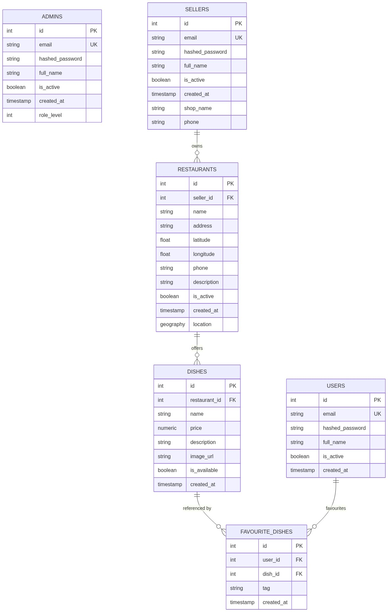
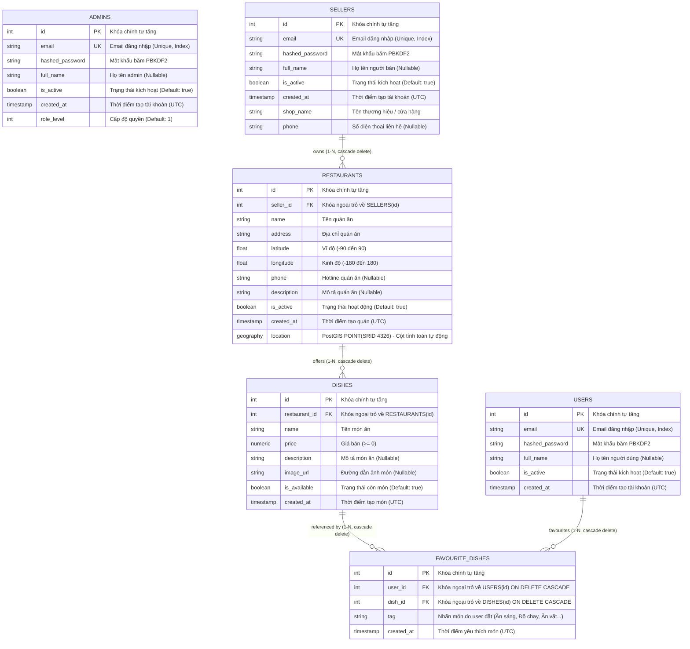

# Thiết kế Cơ sở Dữ liệu (Database Design & Schema) - PTC1

Tài liệu này lưu trữ toàn bộ thiết kế kiến trúc cơ sở dữ liệu, sơ đồ ERD, từ điển dữ liệu (Data Dictionary), các ràng buộc toàn vẹn và mã SQL DDL khởi tạo của hệ thống PTC1 dựa trên mã nguồn hiện hữu tại `server/app/models/`.

---

## 1. Tổng quan Thiết kế

- **Hệ quản trị CSDL:** PostgreSQL 14 (chuẩn hóa quốc tế).
- **Phần mở rộng không gian địa lý:** PostGIS 3.6.1 (hỗ trợ kiểu dữ liệu `GEOGRAPHY(POINT, 4326)` và các hàm tính toán khoảng cách cầu, tìm kiếm lân cận `ST_DWithin`, `ST_Distance`).
- **Mô hình tài khoản (Role Separation):** Phân chia 3 bảng độc lập (`users`, `sellers`, `admins`) dùng chung cấu trúc xác thực qua mixin, giúp tối ưu hóa nghiệp vụ riêng của từng đối tượng và đảm bảo an toàn phân quyền ở tầng dữ liệu.
- **Khách vãng lai (Guest):** Không lưu trữ thông tin trong DB, chỉ truy vấn dữ liệu công khai.

---

## 2. Sơ đồ Thực thể Liên kết (ERD)



> 💡 *Bạn có thể xem bản vẽ vector sắc nét tại [erd-diagram.svg](erd-diagram.svg)*

<details>
<summary><b>Nhấn vào đây để xem mã nguồn sơ đồ (Mermaid code)</b></summary>


</details>

---

## 3. Từ điển Dữ liệu (Data Dictionary)

### 3.1. Bảng `users` (Khách hàng)
Model ORM: `server/app/models/user.py` kế thừa `AccountMixin`.

| Cột | Kiểu dữ liệu | Ràng buộc / Mặc định | Ý nghĩa |
| :--- | :--- | :--- | :--- |
| `id` | `SERIAL` / `INTEGER` | `PRIMARY KEY`, `INDEX` | Định danh người dùng |
| `email` | `VARCHAR(255)` | `NOT NULL`, `UNIQUE`, `INDEX` | Email đăng nhập |
| `hashed_password` | `VARCHAR(255)` | `NOT NULL` | Mật khẩu băm chuẩn PBKDF2-HMAC-SHA256 |
| `full_name` | `VARCHAR(255)` | `NULLABLE`, Default: `NULL` | Họ tên khách hàng |
| `is_active` | `BOOLEAN` | `NOT NULL`, Default: `TRUE` | Trạng thái kích hoạt tài khoản |
| `created_at` | `TIMESTAMP WITH TIME ZONE` | `NOT NULL`, Default: `NOW()` | Thời gian đăng ký (UTC) |

---

### 3.2. Bảng `sellers` (Người bán hàng / Chủ quán ăn)
Model ORM: `server/app/models/seller.py`.

| Cột | Kiểu dữ liệu | Ràng buộc / Mặc định | Ý nghĩa |
| :--- | :--- | :--- | :--- |
| `id` | `SERIAL` / `INTEGER` | `PRIMARY KEY`, `INDEX` | Định danh người bán |
| `email` | `VARCHAR(255)` | `NOT NULL`, `UNIQUE`, `INDEX` | Email đăng nhập |
| `hashed_password` | `VARCHAR(255)` | `NOT NULL` | Mật khẩu băm |
| `full_name` | `VARCHAR(255)` | `NULLABLE`, Default: `NULL` | Tên người đại diện |
| `is_active` | `BOOLEAN` | `NOT NULL`, Default: `TRUE` | Trạng thái tài khoản |
| `created_at` | `TIMESTAMP WITH TIME ZONE` | `NOT NULL`, Default: `NOW()` | Thời gian đăng ký |
| `shop_name` | `VARCHAR(255)` | `NOT NULL` | Tên thương hiệu/gian hàng |
| `phone` | `VARCHAR(50)` | `NULLABLE`, Default: `NULL` | Số điện thoại liên hệ |

---

### 3.3. Bảng `admins` (Quản trị viên hệ thống)
Model ORM: `server/app/models/admin.py`.

| Cột | Kiểu dữ liệu | Ràng buộc / Mặc định | Ý nghĩa |
| :--- | :--- | :--- | :--- |
| `id` | `SERIAL` / `INTEGER` | `PRIMARY KEY`, `INDEX` | Định danh admin |
| `email` | `VARCHAR(255)` | `NOT NULL`, `UNIQUE`, `INDEX` | Email đăng nhập |
| `hashed_password` | `VARCHAR(255)` | `NOT NULL` | Mật khẩu băm |
| `full_name` | `VARCHAR(255)` | `NULLABLE`, Default: `NULL` | Họ tên admin |
| `is_active` | `BOOLEAN` | `NOT NULL`, Default: `TRUE` | Trạng thái tài khoản |
| `created_at` | `TIMESTAMP WITH TIME ZONE` | `NOT NULL`, Default: `NOW()` | Thời gian tạo tài khoản |
| `role_level` | `INTEGER` | `NOT NULL`, Default: `1` | Cấp độ quyền hạn (1: SuperAdmin) |

---

### 3.4. Bảng `restaurants` (Quán ăn / Điểm bán ẩm thực)
Model ORM: `server/app/models/restaurant.py`.

| Cột | Kiểu dữ liệu | Ràng buộc / Mặc định | Ý nghĩa |
| :--- | :--- | :--- | :--- |
| `id` | `SERIAL` / `INTEGER` | `PRIMARY KEY` | Định danh quán ăn |
| `seller_id` | `INTEGER` | `NOT NULL`, `FK(sellers.id ON DELETE CASCADE)`, `INDEX` | Seller sở hữu quán ăn |
| `name` | `VARCHAR(255)` | `NOT NULL` | Tên quán ăn |
| `address` | `VARCHAR(500)` | `NOT NULL` | Địa chỉ cụ thể |
| `latitude` | `DOUBLE PRECISION` | `NOT NULL`, `CHECK (latitude BETWEEN -90.0 AND 90.0)` | Vĩ độ địa lý WGS84 |
| `longitude` | `DOUBLE PRECISION` | `NOT NULL`, `CHECK (longitude BETWEEN -180.0 AND 180.0)` | Kinh độ địa lý WGS84 |
| `phone` | `VARCHAR(50)` | `NULLABLE`, Default: `NULL` | Số điện thoại quán ăn |
| `description` | `VARCHAR(1000)` | `NULLABLE`, Default: `NULL` | Giới thiệu quán ăn |
| `is_active` | `BOOLEAN` | `NOT NULL`, Default: `TRUE` | Trạng thái mở/đóng cửa |
| `created_at` | `TIMESTAMP WITH TIME ZONE` | `NOT NULL`, Default: `NOW()` | Ngày tạo quán |
| `location` | `GEOGRAPHY(POINT, 4326)` | `GENERATED ALWAYS AS (...) STORED`, `SPATIAL INDEX` | Tọa độ PostGIS phục vụ tìm quán lân cận |

---

### 3.5. Bảng `dishes` (Món ăn / Thực đơn của Quán)
Quan hệ: Thuộc sở hữu của 1 Quán ăn (1 Restaurant - N Dishes).

| Cột | Kiểu dữ liệu | Ràng buộc / Mặc định | Ý nghĩa |
| :--- | :--- | :--- | :--- |
| `id` | `SERIAL` / `INTEGER` | `PRIMARY KEY` | Khóa chính định danh món ăn |
| `restaurant_id` | `INTEGER` | `NOT NULL`, `FK(restaurants.id ON DELETE CASCADE)`, `INDEX` | Quán ăn sở hữu món này |
| `name` | `VARCHAR(255)` | `NOT NULL` | Tên món ăn (vd: "Cơm tấm sườn nướng") |
| `price` | `NUMERIC(12, 2)` | `NOT NULL`, `CHECK (price >= 0)` | Đơn giá món ăn (dùng NUMERIC tránh sai số) |
| `description` | `VARCHAR(1000)` | `NULLABLE`, Default: `NULL` | Giới thiệu, nguyên liệu, hương vị món ăn |
| `image_url` | `VARCHAR(1000)` | `NULLABLE`, Default: `NULL` | Đường dẫn ảnh minh họa món ăn |
| `is_available` | `BOOLEAN` | `NOT NULL`, Default: `TRUE` | Trạng thái món (còn món / tạm hết món) |
| `created_at` | `TIMESTAMP WITH TIME ZONE` | `NOT NULL`, Default: `NOW()` | Thời gian tạo món (UTC) |

---

### 3.6. Bảng `favourite_dishes` (Món ăn yêu thích của User kèm Tag)
Quan hệ:
- 1 User có nhiều món ăn yêu thích (`users ||--o{ favourite_dishes`, 1-N).
- 1 Món ăn có thể được nhiều User yêu thích (`dishes ||--o{ favourite_dishes`, 1-N).
- Bảng này đóng vai trò bảng trung gian (Junction Table) liên kết Người dùng (`users`) với Món ăn (`dishes`), kèm khóa ngoại trỏ về `users(id)` và thêm trường `tag` phân loại tùy chỉnh của người dùng.

| Cột | Kiểu dữ liệu | Ràng buộc / Mặc định | Ý nghĩa & Mục đích |
| :--- | :--- | :--- | :--- |
| `id` | `SERIAL` / `INTEGER` | `PRIMARY KEY` | Khóa chính bản ghi món yêu thích |
| `user_id` | `INTEGER` | `NOT NULL`, `FK(users.id ON DELETE CASCADE)`, `INDEX` | **Khóa ngoại trỏ về `users.id`**: Xác định User sở hữu mục yêu thích này. Khi User bị xóa, danh sách yêu thích tự động bị xóa theo. |
| `dish_id` | `INTEGER` | `NOT NULL`, `FK(dishes.id ON DELETE CASCADE)`, `INDEX` | **Khóa ngoại trỏ về `dishes.id`**: Xác định Món ăn được yêu thích (thuộc bảng `dishes`). Khi quán xóa món, các mục yêu thích trỏ đến món này cũng tự động bị xóa. |
| `tag` | `VARCHAR(100)` | `NULLABLE`, Default: `NULL`, `INDEX` | Nhãn/Tag người dùng tự đặt (vd: *"Ăn sáng"*, *"Đồ chay"*, *"Healthy"*, *"Ăn vặt"*, *"Món quen"*) |
| `created_at` | `TIMESTAMP WITH TIME ZONE` | `NOT NULL`, Default: `NOW()` | Thời điểm người dùng nhấn yêu thích món |

---

## 4. Các Ràng buộc & Chỉ mục (Indexes & Constraints)

1. **Ràng buộc kiểm tra hợp lệ tọa độ (Check Constraints):**
   - `ck_restaurant_latitude`: `latitude >= -90.0 AND latitude <= 90.0`
   - `ck_restaurant_longitude`: `longitude >= -180.0 AND longitude <= 180.0`
2. **Ràng buộc kiểm tra giá món ăn:**
   - `ck_dish_price`: `price >= 0` (đơn giá món ăn không được phép âm).
3. **Khóa ngoại và hành vi Cascade (Foreign Key):**
   - `restaurants.seller_id` trỏ đến `sellers.id` với `ON DELETE CASCADE`: Khi một tài khoản Seller bị xóa, toàn bộ quán ăn thuộc sở hữu của Seller đó sẽ tự động bị xóa theo.
   - `dishes.restaurant_id` trỏ đến `restaurants.id` với `ON DELETE CASCADE`: Khi một Quán ăn bị xóa, toàn bộ danh sách món ăn thuộc quán đó sẽ tự động bị xóa theo để tránh dữ liệu mồ côi.
   - `favourite_dishes.user_id` trỏ đến `users.id` với `ON DELETE CASCADE`: **Khóa ngoại liên kết người dùng**; khi tài khoản User bị xóa, các món yêu thích của user đó tự động được dọn dẹp.
   - `favourite_dishes.dish_id` trỏ đến `dishes.id` với `ON DELETE CASCADE`: Khi quán ăn xóa một món, các bản ghi yêu thích món đó của user cũng tự động bị xóa.
4. **Ràng buộc duy nhất (Unique Constraint) cho Favourite Dishes:**
   - `uq_user_favourite_dish`: `UNIQUE (user_id, dish_id)` đảm bảo mỗi người dùng chỉ yêu thích một món ăn 1 lần (có thể gắn/sửa nhãn `tag`).
5. **Chỉ mục tổng hợp (Composite B-tree Index):**
   - `ix_restaurants_lat_lon` trên `(latitude, longitude)` giúp tăng tốc các truy vấn lọc tọa độ phẳng.
6. **Chỉ mục không gian (Spatial GiST Index):**
   - Tạo trên cột `location`, cho phép hàm `ST_DWithin` và `ST_Distance` tìm kiếm các quán ăn trong bán kính $R$ mét với độ phức tạp $O(\log N)$.
7. **Chỉ mục tra cứu món theo quán (B-tree Index):**
   - `ix_dishes_restaurant_id` trên cột `restaurant_id` của bảng `dishes`, giúp truy vấn danh sách thực đơn của quán ăn cực nhanh.
8. **Chỉ mục tra cứu món yêu thích của User:**
   - `ix_favourite_dishes_user_id`: Tối ưu câu lệnh lấy danh sách món yêu thích của 1 user.
   - `ix_favourite_dishes_tag`: Tối ưu lọc danh sách món yêu thích theo tag (ví dụ: *"Lấy tất cả món ăn sáng yêu thích của tôi"*).
9. **Cột tính toán tự sinh (Stored Generated Column):**
   - Cột `location` được sinh tự động ngay trong PostgreSQL mỗi khi `longitude` hoặc `latitude` được thêm mới hoặc chỉnh sửa:
     ```sql
     ST_SetSRID(ST_MakePoint(longitude, latitude), 4326)::geography
     ```

---

## 5. Kịch bản DDL SQL thuần (PostgreSQL Pure SQL Script)

Bạn có thể chạy trực tiếp kịch bản SQL này trên bất kỳ công cụ quản trị PostgreSQL nào (DBeaver, pgAdmin, DataGrip, psql):

```sql
-- 1. Kích hoạt phần mở rộng PostGIS
CREATE EXTENSION IF NOT EXISTS postgis;

-- 2. Bảng users
CREATE TABLE IF NOT EXISTS users (
    id SERIAL PRIMARY KEY,
    email VARCHAR(255) NOT NULL UNIQUE,
    hashed_password VARCHAR(255) NOT NULL,
    full_name VARCHAR(255) DEFAULT NULL,
    is_active BOOLEAN NOT NULL DEFAULT TRUE,
    created_at TIMESTAMPTZ NOT NULL DEFAULT NOW()
);
CREATE INDEX IF NOT EXISTS ix_users_id ON users (id);
CREATE INDEX IF NOT EXISTS ix_users_email ON users (email);

-- 3. Bảng sellers
CREATE TABLE IF NOT EXISTS sellers (
    id SERIAL PRIMARY KEY,
    email VARCHAR(255) NOT NULL UNIQUE,
    hashed_password VARCHAR(255) NOT NULL,
    full_name VARCHAR(255) DEFAULT NULL,
    is_active BOOLEAN NOT NULL DEFAULT TRUE,
    created_at TIMESTAMPTZ NOT NULL DEFAULT NOW(),
    shop_name VARCHAR(255) NOT NULL,
    phone VARCHAR(50) DEFAULT NULL
);
CREATE INDEX IF NOT EXISTS ix_sellers_id ON sellers (id);
CREATE INDEX IF NOT EXISTS ix_sellers_email ON sellers (email);

-- 4. Bảng admins
CREATE TABLE IF NOT EXISTS admins (
    id SERIAL PRIMARY KEY,
    email VARCHAR(255) NOT NULL UNIQUE,
    hashed_password VARCHAR(255) NOT NULL,
    full_name VARCHAR(255) DEFAULT NULL,
    is_active BOOLEAN NOT NULL DEFAULT TRUE,
    created_at TIMESTAMPTZ NOT NULL DEFAULT NOW(),
    role_level INTEGER NOT NULL DEFAULT 1
);
CREATE INDEX IF NOT EXISTS ix_admins_id ON admins (id);
CREATE INDEX IF NOT EXISTS ix_admins_email ON admins (email);

-- 5. Bảng restaurants
CREATE TABLE IF NOT EXISTS restaurants (
    id SERIAL PRIMARY KEY,
    seller_id INTEGER NOT NULL REFERENCES sellers(id) ON DELETE CASCADE,
    name VARCHAR(255) NOT NULL,
    address VARCHAR(500) NOT NULL,
    latitude DOUBLE PRECISION NOT NULL,
    longitude DOUBLE PRECISION NOT NULL,
    phone VARCHAR(50) DEFAULT NULL,
    description VARCHAR(1000) DEFAULT NULL,
    is_active BOOLEAN NOT NULL DEFAULT TRUE,
    created_at TIMESTAMPTZ NOT NULL DEFAULT NOW(),
    location GEOGRAPHY(POINT, 4326) GENERATED ALWAYS AS (
        ST_SetSRID(ST_MakePoint(longitude, latitude), 4326)::geography
    ) STORED,
    CONSTRAINT ck_restaurant_latitude CHECK (latitude >= -90.0 AND latitude <= 90.0),
    CONSTRAINT ck_restaurant_longitude CHECK (longitude >= -180.0 AND longitude <= 180.0)
);

CREATE INDEX IF NOT EXISTS ix_restaurants_seller_id ON restaurants (seller_id);
CREATE INDEX IF NOT EXISTS ix_restaurants_lat_lon ON restaurants (latitude, longitude);
CREATE INDEX IF NOT EXISTS idx_restaurants_location ON restaurants USING GIST (location);

-- 6. Bảng dishes (Món ăn thuộc quán ăn - Quan hệ 1-N)
CREATE TABLE IF NOT EXISTS dishes (
    id SERIAL PRIMARY KEY,
    restaurant_id INTEGER NOT NULL REFERENCES restaurants(id) ON DELETE CASCADE,
    name VARCHAR(255) NOT NULL,
    price NUMERIC(12, 2) NOT NULL,
    description VARCHAR(1000) DEFAULT NULL,
    image_url VARCHAR(1000) DEFAULT NULL,
    is_available BOOLEAN NOT NULL DEFAULT TRUE,
    created_at TIMESTAMPTZ NOT NULL DEFAULT NOW(),
    CONSTRAINT ck_dish_price CHECK (price >= 0)
);

CREATE INDEX IF NOT EXISTS ix_dishes_restaurant_id ON dishes (restaurant_id);

-- 7. Bảng favourite_dishes (Món ăn yêu thích của User kèm Tag - Khóa ngoại User & Dish)
CREATE TABLE IF NOT EXISTS favourite_dishes (
    id SERIAL PRIMARY KEY,
    user_id INTEGER NOT NULL REFERENCES users(id) ON DELETE CASCADE,
    dish_id INTEGER NOT NULL REFERENCES dishes(id) ON DELETE CASCADE,
    tag VARCHAR(100) DEFAULT NULL,
    created_at TIMESTAMPTZ NOT NULL DEFAULT NOW(),
    CONSTRAINT uq_user_favourite_dish UNIQUE (user_id, dish_id)
);

CREATE INDEX IF NOT EXISTS ix_favourite_dishes_user_id ON favourite_dishes (user_id);
CREATE INDEX IF NOT EXISTS ix_favourite_dishes_dish_id ON favourite_dishes (dish_id);
CREATE INDEX IF NOT EXISTS ix_favourite_dishes_tag ON favourite_dishes (tag);
```
