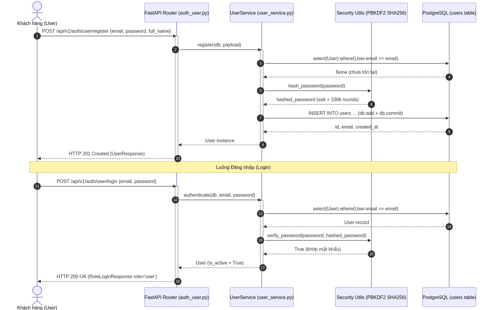
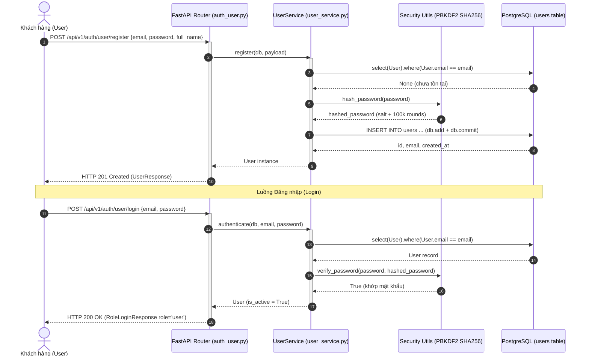
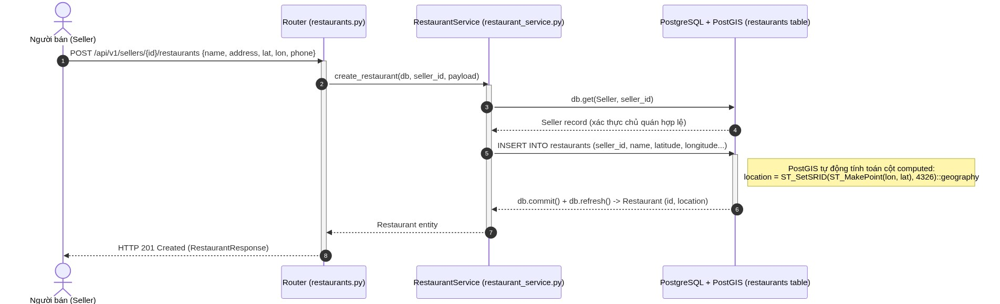
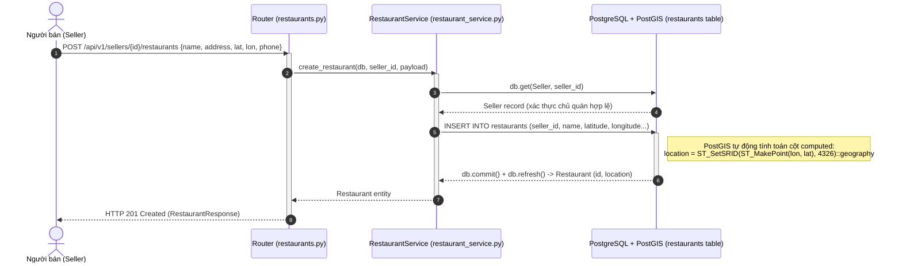
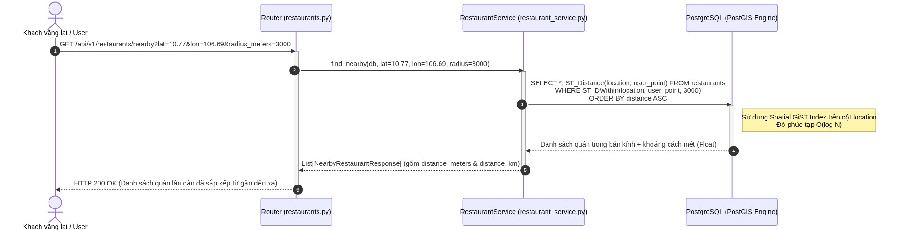
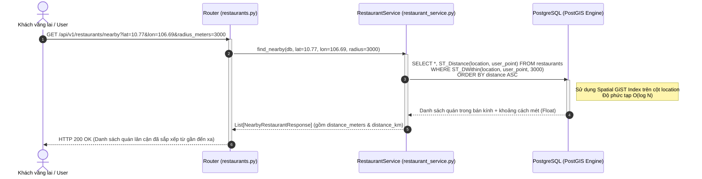
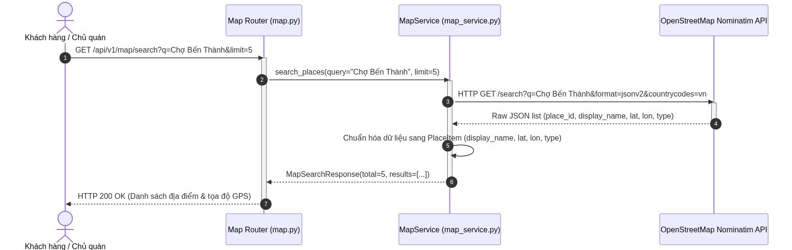
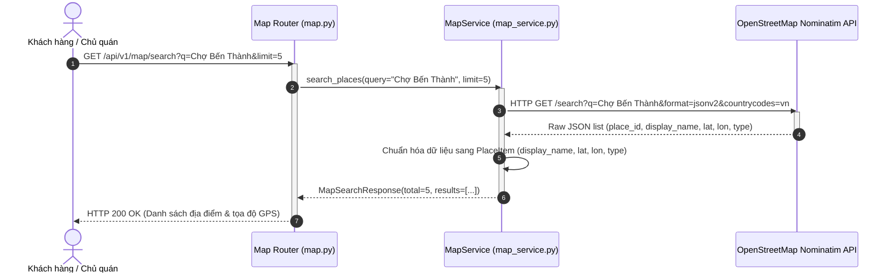

# Sơ đồ Tuần tự Hệ thống (Sequence Diagrams) - PTC1

Tài liệu này mô tả chi tiết các luồng xử lý tuần tự (Sequence Diagrams) giữa **Tác nhân (Actors)** và **Các thành phần phần mềm (Components)** trong hệ thống PTC1, bám sát **100% mã nguồn thực tế hiện có** tại `server/app/`.

---

## 1. Định nghĩa Tác nhân (Actors) & Thành phần tham gia (Participants)

### 1.1. Các Tác nhân (Actors)
- 👤 **Khách hàng (User):** Người dùng dịch vụ, thực hiện đăng ký, đăng nhập tài khoản, tra cứu quán ăn.
- 🏪 **Người bán (Seller):** Chủ cửa hàng/quán ăn, thực hiện đăng ký gian hàng và quản lý danh sách quán ăn của mình.
- 🌐 **Khách vãng lai (Guest):** Người dùng chưa đăng nhập, được phép duyệt tìm kiếm quán ăn và tra cứu vị trí địa lý.
- 🗺️ **Hệ thống bản đồ ngoài (OpenStreetMap Nominatim):** Dịch vụ bên thứ ba cung cấp dữ liệu bản đồ và tọa độ địa lý.

### 1.2. Các Thành phần Hệ thống (System Participants)
- 🚪 **FastAPI APIRouter:** Tầng Controller tiếp nhận HTTP Request, xác thực schema Pydantic và điều phối.
- ⚙️ **Service Layer (`UserService`, `RestaurantService`, `MapService`):** Tầng xử lý logic nghiệp vụ.
- 🔐 **Security Utils (`server.app.core.security`):** Băm và xác thực mật khẩu bằng thuật toán chuẩn PBKDF2-HMAC-SHA256 (100.000 vòng lặp).
- 🗄️ **Database Layer (PostgreSQL 14 & PostGIS Engine):** Lưu trữ dữ liệu quan hệ và thực thi các truy vấn không gian (`ST_DWithin`, `ST_Distance`).

---

## 2. Luồng 1: Xác thực Tài khoản (Đăng ký & Đăng nhập)

Áp dụng cho module: `server/app/api/v1/endpoints/auth_user.py` & `server/app/services/user_service.py`.

<b>Xem mã nguồn Mermaid</b>

### Diễn giải chi tiết:
1. **Đăng ký:**
   - Client gửi `email`, `password`, `full_name`.
   - `UserService` kiểm tra sự tồn tại của `email` trong bảng `users`. Nếu đã tồn tại -> Trả về `400 Bad Request`.
   - Nếu hợp lệ -> Gọi `security.hash_password` sinh chuỗi muối ngẫu nhiên và băm qua PBKDF2-HMAC-SHA256.
   - Thêm bản ghi vào DB, `commit`, và trả về `UserResponse` (HTTP 201).
2. **Đăng nhập:**
   - Client gửi `email` và `password`.
   - `UserService` tìm user trong DB -> Kiểm tra chuỗi băm bằng `verify_password`. Nếu sai -> Trả về `401 Unauthorized`.
   - Kiểm tra `is_active` -> Trả về `RoleLoginResponse` với thông tin User và `role: "user"`.

---

## 3. Luồng 2: Seller Tạo mới Quán ăn & Tự động sinh tọa độ PostGIS

Áp dụng cho module: `server/app/api/v1/endpoints/restaurants.py` & `server/app/services/restaurant_service.py`.

<b>Xem mã nguồn Mermaid</b>

### Diễn giải chi tiết:
1. Người bán gửi thông tin quán kèm tọa độ WGS84 (`latitude`, `longitude`).
2. Router kiểm tra ràng buộc kiểu dữ liệu qua Pydantic schema `RestaurantCreate`.
3. `RestaurantService` kiểm tra `seller_id` có tồn tại trong bảng `sellers` không. Nếu không có -> Trả về `404 Not Found`.
4. Khi insert vào bảng `restaurants`, engine PostgreSQL + PostGIS tự động kích hoạt biểu thức tính toán lưu trữ:
   $$location = \text{ST\_SetSRID}(\text{ST\_MakePoint}(longitude, latitude), 4326)::\text{geography}$$
5. Quán ăn được tạo thành công với khóa ngoại gắn liền với Seller, trả về HTTP 201 Created.

---

## 4. Luồng 3: Tìm kiếm Quán ăn Gần đây bằng GPS (Spatial Radius Search)

Áp dụng cho module: `server/app/api/v1/endpoints/restaurants.py` (Endpoint `GET /api/v1/restaurants/nearby`).

<b>Xem mã nguồn Mermaid</b>

### Diễn giải chi tiết:
1. Khách hàng hoặc khách vãng lai gửi tọa độ hiện tại (`latitude`, `longitude`) kèm bán kính tìm kiếm (mặc định 5000 mét, tối đa 50000 mét).
2. Service khởi tạo điểm vị trí người dùng dưới dạng `Geography POINT(SRID 4326)`.
3. Câu lệnh SQL sử dụng hàm không gian `ST_DWithin` kết hợp **Spatial GiST Index** trên cột `location` để quét nhanh các quán trong bán kính mà không cần quét toàn bộ bảng (table scan).
4. Hàm `ST_Distance` tính toán chính xác khoảng cách trắc địa đường cong mặt cầu (WGS84 ellipsoid).
5. Trả về danh sách quán đã sắp xếp theo khoảng cách tăng dần kèm cả số mét (`distance_meters`) và km (`distance_km`).

---

## 5. Luồng 4: Tra cứu Tọa độ Địa lý qua OpenStreetMap Nominatim

Áp dụng cho module: `server/app/api/v1/endpoints/map.py` & `server/app/services/map_service.py`.

<b>Xem mã nguồn Mermaid</b>

### Diễn giải chi tiết:
1. Client nhập tên địa điểm hoặc đường phố cần tìm.
2. `MapService` thiết lập `User-Agent` hợp lệ theo quy định sử dụng của OpenStreetMap Nominatim.
3. Gửi truy vấn HTTP GET tới endpoint tìm kiếm của Nominatim với giới hạn quốc gia Việt Nam (`countrycodes=vn`).
4. Chuẩn hóa dữ liệu trả về thành cấu trúc DTO sạch gồm: `display_name`, `latitude`, `longitude`, `type`.
5. Trả về kết quả phục vụ hiển thị gợi ý tìm kiếm hoặc tự động điền tọa độ khi chủ quán tạo quán ăn mới.
