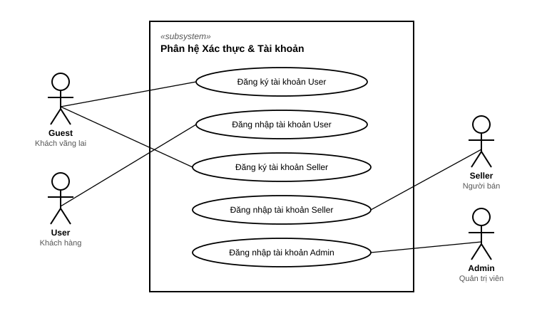
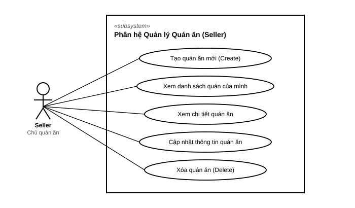
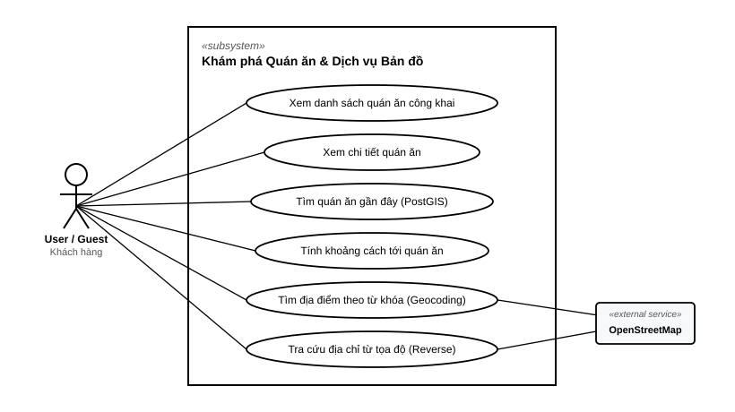

# Tài liệu Đặc tả Use Case: Hệ thống PTC1

Tài liệu này tổng hợp toàn bộ các **Tác nhân (Actors)**, **Sơ đồ Use Case** và **Đặc tả chi tiết từng trường hợp sử dụng (Use Cases)** của hệ thống PTC1, bám sát **100% mã nguồn thực tế hiện có** tại `server/app/`.

---

## 1. Danh sách Tác nhân (Actors)

| Tác nhân (Actor) | Biểu tượng | Mô tả vai trò & Quyền hạn | Lưu trữ DB |
| :--- | :---: | :--- | :--- |
| **Khách vãng lai** *(Guest)* | 🌐 | Người dùng truy cập hệ thống nhưng chưa đăng nhập. Được phép xem danh sách quán, xem chi tiết, tìm quán ăn lân cận theo vị trí GPS và tra cứu địa chỉ bản đồ. | Không lưu trữ trong DB |
| **Khách hàng** *(User)* | 👤 | Người dùng đã đăng ký và đăng nhập tài khoản. Thừa hưởng toàn bộ quyền của Khách vãng lai và có tài khoản định danh để sử dụng các tiện ích cá nhân. | Bảng `users` |
| **Người bán / Chủ quán** *(Seller)* | 🏪 | Đối tác sở hữu cửa hàng/quán ăn. Đăng ký thông tin gian hàng (`shop_name`, `phone`) và quản lý toàn bộ các quán ăn thuộc quyền sở hữu của mình. | Bảng `sellers` |
| **Quản trị viên** *(Admin)* | 🛡️ | Quản trị viên hệ thống có cấp bậc quyền hạn (`role_level`), quản trị vận hành nền tảng. | Bảng `admins` |
| **OpenStreetMap Nominatim** | 🗺️ | Hệ thống bản đồ bên thứ 3 cung cấp API Geocoding (chuyển đổi địa chỉ chữ ⇄ tọa độ GPS WGS84). | Dịch vụ ngoài |

---

## 2. Sơ đồ Use Case Chuẩn UML (UML Standard Diagrams)

Các sơ đồ dưới đây được thiết kế theo **chuẩn UML 2.5 quốc tế** (tương tự tài liệu *uml-diagrams.org*):
- 👤 **Người que (Stickman):** Đại diện cho các tác nhân con người (User, Seller, Guest, Admin).
- 🔲 **Khung chữ nhật (System Boundary Box):** Đại diện cho ranh giới hệ thống/phân hệ (`<<subsystem>>`).
- ⬭ **Hình elip (Use Case Ellipses):** Đại diện cho từng chức năng/hành động.
- ➖ **Đường nối liên kết (Solid Association Lines):** Biểu diễn mối quan hệ giữa Actor và Use Case.
- 🏢 **Hệ thống ngoài (Secondary Actor):** Nằm bên phải ranh giới hệ thống (OpenStreetMap API).

---

### 2.1. Sơ đồ Use Case Tổng thể (System Overview)

---

### 2.2. Phân hệ 1: Xác thực & Quản lý Tài khoản (Authentication)
Dành cho các tác nhân: **Khách vãng lai (Guest)**, **Khách hàng (User)**, **Người bán (Seller)** và **Quản trị viên (Admin)**.

---

### 2.3. Phân hệ 2: Quản lý Quán ăn dành cho Người bán (Seller Restaurant Management)
Dành riêng cho tác nhân **Người bán (Seller)** thực hiện các thao tác quản lý quán ăn của mình.

---

### 2.4. Phân hệ 3 & 4: Khám phá Quán ăn công khai & Dịch vụ Bản đồ (Public & Map)
Dành cho **Khách vãng lai (Guest)** và **Khách hàng (User)** tra cứu quán ăn, tìm quán gần đây qua PostGIS GPS và tương tác với hệ thống ngoài **OpenStreetMap API**.

---

## 3. Đặc tả chi tiết từng Use Case (Use Case Specifications)

### 3.1. Phân hệ 1: Xác thực & Quản lý Tài khoản (Authentication)

#### UC-AUTH-01: Đăng ký tài khoản User
- **Actor chính:** Khách vãng lai (Guest).
- **Tiền điều kiện:** Email chưa từng được đăng ký trong bảng `users`.
- **Hậu điều kiện:** Bản ghi mới được tạo trong bảng `users` với mật khẩu đã băm PBKDF2-HMAC-SHA256 (100.000 rounds).
- **Luồng chính (Happy Path):**
  1. Người dùng nhập: `email`, `password`, `full_name` (tùy chọn).
  2. Router kiểm tra định dạng email và độ dài mật khẩu (tối thiểu 6 ký tự).
  3. `UserService` kiểm tra email chưa tồn tại trong bảng `users`.
  4. Hệ thống băm mật khẩu với muối ngẫu nhiên qua `security.hash_password`.
  5. Hệ thống lưu tài khoản vào DB và trả về `UserResponse` kèm HTTP 201 Created.
- **Luồng ngoại lệ:**
  - *Email đã tồn tại:* Hệ thống trả về HTTP `400 Bad Request` ("Email này đã được đăng ký tài khoản.").
- **API Endpoint:** `POST /api/v1/auth/user/register`.

#### UC-AUTH-02: Đăng nhập User
- **Actor chính:** Khách hàng (User).
- **Tiền điều kiện:** Tài khoản User đã đăng ký và đang kích hoạt (`is_active = True`).
- **Luồng chính:**
  1. Người dùng gửi `email` và `password`.
  2. `UserService` truy vấn tìm `User` theo email.
  3. Kiểm tra tính trùng khớp của mật khẩu qua `security.verify_password`.
  4. Trả về HTTP `200 OK` với thông tin User và vai trò `role: "user"`.
- **Luồng ngoại lệ:**
  - *Sai email hoặc sai mật khẩu:* Trả về HTTP `401 Unauthorized` ("Email hoặc mật khẩu không chính xác.").
  - *Tài khoản bị khóa (`is_active = False`):* Trả về HTTP `403 Forbidden` ("Tài khoản đã bị vô hiệu hóa.").
- **API Endpoint:** `POST /api/v1/auth/user/login`.

#### UC-AUTH-03: Đăng ký tài khoản Seller
- **Actor chính:** Khách vãng lai (Guest).
- **Tiền điều kiện:** Email chưa từng đăng ký trong bảng `sellers`.
- **Luồng chính:**
  1. Người bán nhập: `email`, `password`, `shop_name`, `phone` (tùy chọn), `full_name` (tùy chọn).
  2. Hệ thống băm mật khẩu và lưu vào bảng `sellers`.
  3. Trả về thông tin `SellerResponse` kèm HTTP 201 Created.
- **API Endpoint:** `POST /api/v1/auth/seller/register`.

#### UC-AUTH-04: Đăng nhập Seller
- **Actor chính:** Người bán (Seller).
- **Luồng chính:** Tương tự đăng nhập User, xác thực qua bảng `sellers`, trả về vai trò `role: "seller"` cùng `shop_name` và `phone`.
- **API Endpoint:** `POST /api/v1/auth/seller/login`.

#### UC-AUTH-05: Đăng nhập Admin
- **Actor chính:** Quản trị viên (Admin).
- **Luồng chính:** Xác thực qua bảng `admins`, trả về vai trò `role: "admin"` và cấp độ quyền `role_level`.
- **API Endpoint:** `POST /api/v1/auth/admin/login`.

---

### 3.2. Phân hệ 2: Dịch vụ Bản đồ (Map Services via OpenStreetMap)

#### UC-MAP-01: Tìm kiếm địa điểm theo từ khóa (Forward Geocoding)
- **Actor chính:** Guest, User, Seller.
- **Tiền điều kiện:** Kết nối mạng khả dụng để gọi OpenStreetMap Nominatim API.
- **Luồng chính:**
  1. Người dùng nhập từ khóa tìm kiếm `q` (vd: "Chợ Bến Thành") và giới hạn kết quả `limit` (1-20).
  2. `MapService` gửi request HTTP GET tới OpenStreetMap Nominatim với `format=jsonv2&countrycodes=vn`.
  3. Hệ thống chuẩn hóa danh sách địa điểm sang `PlaceItem` (`display_name`, `latitude`, `longitude`, `type`).
  4. Trả về danh sách gợi ý cho Client (HTTP 200).
- **Luồng ngoại lệ:**
  - *Lỗi mạng hoặc timeout từ Nominatim:* Trả về HTTP `502 Bad Gateway` hoặc mảng rỗng có kiểm soát.
- **API Endpoint:** `GET /api/v1/map/search`.

#### UC-MAP-02: Tra cứu địa chỉ từ tọa độ GPS (Reverse Geocoding)
- **Actor chính:** Guest, User, Seller.
- **Luồng chính:**
  1. Người dùng gửi tọa độ GPS: `latitude`, `longitude`.
  2. Hệ thống kiểm tra tọa độ hợp lệ (-90 <= lat <= 90; -180 <= lon <= 180).
  3. Gọi Nominatim Reverse API và trả về chuỗi địa chỉ chi tiết tương ứng.
- **API Endpoint:** `GET /api/v1/map/reverse`.

---

### 3.3. Phân hệ 3: Khám phá Quán ăn công khai (Public Restaurants)

#### UC-PUB-01: Xem danh sách quán ăn công khai
- **Actor chính:** Khách vãng lai (Guest), Khách hàng (User).
- **Luồng chính:**
  1. Client gửi yêu cầu với tham số phân trang: `skip` (mặc định 0), `limit` (mặc định 20, tối đa 100).
  2. Hệ thống truy vấn các quán có `is_active = True`, sắp xếp `id DESC`.
  3. Trả về danh sách quán ăn (HTTP 200).
- **API Endpoint:** `GET /api/v1/restaurants`.

#### UC-PUB-02: Xem chi tiết thông tin quán ăn
- **Actor chính:** Khách vãng lai (Guest), Khách hàng (User).
- **Luồng chính:**
  1. Client gửi `restaurant_id`.
  2. Hệ thống tìm quán theo ID và đảm bảo `is_active = True`.
  3. Trả về thông tin chi tiết: tên quán, địa chỉ, tọa độ, hotline, mô tả.
- **Luồng ngoại lệ:** Nếu quán không tồn tại hoặc đã bị ẩn -> Trả về HTTP `404 Not Found`.
- **API Endpoint:** `GET /api/v1/restaurants/{restaurant_id}`.

#### UC-PUB-03: Tìm kiếm quán ăn gần đây theo vị trí GPS (Spatial Radius Search)
- **Actor chính:** Khách vãng lai (Guest), Khách hàng (User).
- **Tiền điều kiện:** PostgreSQL đã cài đặt phần mở rộng PostGIS.
- **Luồng chính:**
  1. Client gửi tọa độ hiện tại (`latitude`, `longitude`), bán kính tìm kiếm `radius_meters` (mặc định 5000m, tối đa 50000m) và `limit`.
  2. `RestaurantService` khởi tạo điểm vị trí người dùng dạng PostGIS `Geography POINT(SRID 4326)`.
  3. PostgreSQL sử dụng hàm `ST_DWithin` trên **Spatial GiST Index** của cột `location` để quét nhanh các quán trong bán kính.
  4. Hàm `ST_Distance` tính toán chính xác khoảng cách trắc địa đường cong mặt cầu theo mét.
  5. Sắp xếp danh sách theo khoảng cách từ gần đến xa và trả về `NearbyRestaurantResponse` (kèm `distance_meters` và `distance_km`).
- **API Endpoint:** `GET /api/v1/restaurants/nearby`.

#### UC-PUB-04: Tính khoảng cách từ người dùng tới một quán cụ thể
- **Actor chính:** Khách vãng lai (Guest), Khách hàng (User).
- **Luồng chính:**
  1. Client gửi `restaurant_id`, `user_lat`, `user_lon`.
  2. Hệ thống dùng PostGIS tính khoảng cách thực tế giữa vị trí người dùng và vị trí quán.
  3. Trả về `DistanceResponse` (`distance_meters` và `distance_km` làm tròn 2 chữ số thập phân).
- **API Endpoint:** `GET /api/v1/restaurants/{restaurant_id}/distance`.

---

### 3.4. Phân hệ 4: Quản lý Quán ăn dành cho Seller (Seller Restaurants Management)

#### UC-REST-01: Tạo mới quán ăn
- **Actor chính:** Người bán (Seller).
- **Tiền điều kiện:** Tài khoản Seller hợp lệ (`seller_id` tồn tại trong bảng `sellers`).
- **Luồng chính:**
  1. Seller nhập: `name`, `address`, `latitude`, `longitude`, `phone` (tùy chọn), `description` (tùy chọn).
  2. Router kiểm tra ràng buộc tọa độ WGS84 (-90 <= lat <= 90; -180 <= lon <= 180).
  3. Service insert vào bảng `restaurants` gắn khóa ngoại `seller_id`.
  4. PostGIS tự động tính toán cột computed `location` dạng `geography(POINT, 4326)`.
  5. Trả về `RestaurantResponse` kèm HTTP 201 Created.
- **API Endpoint:** `POST /api/v1/sellers/{seller_id}/restaurants`.

#### UC-REST-02: Xem danh sách quán ăn của mình
- **Actor chính:** Người bán (Seller).
- **Luồng chính:**
  1. Seller yêu cầu danh sách quán theo `seller_id`.
  2. Hệ thống truy vấn toàn bộ các quán có `seller_id == seller_id` (kể cả các quán đang tạm đóng cửa `is_active = False`).
  3. Trả về danh sách quán của riêng Seller đó.
- **API Endpoint:** `GET /api/v1/sellers/{seller_id}/restaurants`.

#### UC-REST-03: Cập nhật thông tin quán ăn
- **Actor chính:** Người bán (Seller).
- **Tiền điều kiện:** Quán ăn tồn tại và thuộc quyền sở hữu của `seller_id`.
- **Luồng chính:**
  1. Seller gửi thông tin cần cập nhật: `name`, `address`, `latitude`, `longitude`, `phone`, `description`, `is_active`.
  2. Hệ thống kiểm tra quyền sở hữu (`restaurant.seller_id == seller_id`).
  3. Cập nhật các trường và lưu vào DB. Cột `location` PostGIS tự động cập nhật nếu tọa độ thay đổi.
  4. Trả về thông tin quán sau khi cập nhật (HTTP 200).
- **Luồng ngoại lệ:** Nếu quán không thuộc về `seller_id` -> Trả về HTTP `404 Not Found`.
- **API Endpoint:** `PUT /api/v1/sellers/{seller_id}/restaurants/{restaurant_id}`.

#### UC-REST-04: Xóa quán ăn
- **Actor chính:** Người bán (Seller).
- **Tiền điều kiện:** Quán ăn thuộc quyền sở hữu của Seller.
- **Luồng chính:**
  1. Seller gửi yêu cầu xóa với `seller_id` và `restaurant_id`.
  2. Hệ thống xác thực quyền sở hữu.
  3. Thực hiện xóa bản ghi khỏi bảng `restaurants`.
  4. Trả về HTTP `200 OK` xác nhận xóa thành công.
- **API Endpoint:** `DELETE /api/v1/sellers/{seller_id}/restaurants/{restaurant_id}`.

---

## 4. Ma trận phân quyền chức năng (Role-Permission Matrix)

| Chức năng / Use Case | Khách vãng lai (Guest) | Khách hàng (User) | Người bán (Seller) | Quản trị viên (Admin) |
| :--- | :---: | :---: | :---: | :---: |
| Đăng ký / Đăng nhập tài khoản | ✓ | ✓ | ✓ | ✓ |
| Tìm kiếm địa chỉ & tọa độ (OpenStreetMap) | ✓ | ✓ | ✓ | ✓ |
| Xem danh sách & Chi tiết quán công khai | ✓ | ✓ | ✓ | ✓ |
| Tìm quán gần đây theo GPS (PostGIS) | ✓ | ✓ | ✓ | ✓ |
| Tính khoảng cách tới quán ăn | ✓ | ✓ | ✓ | ✓ |
| Tạo / Quản lý quán ăn của mình | ✗ | ✗ | **✓ (Chính chủ)** | ✗ |
| Quản trị hệ thống & Xem dữ liệu nền tảng | ✗ | ✗ | ✗ | **✓** |
